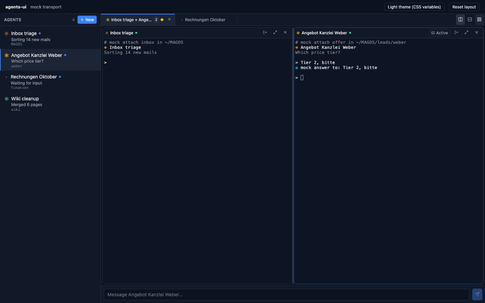
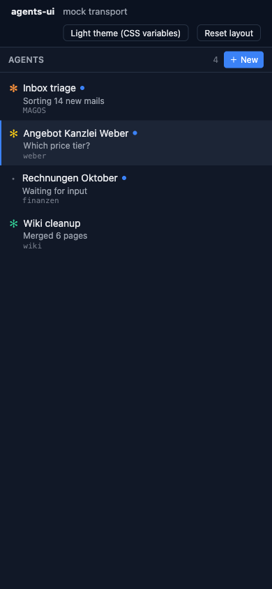
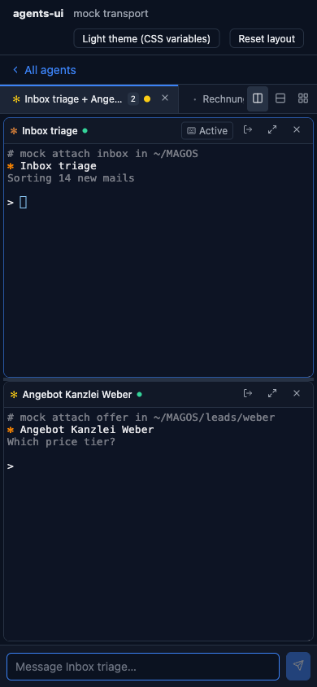
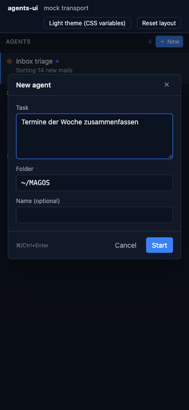
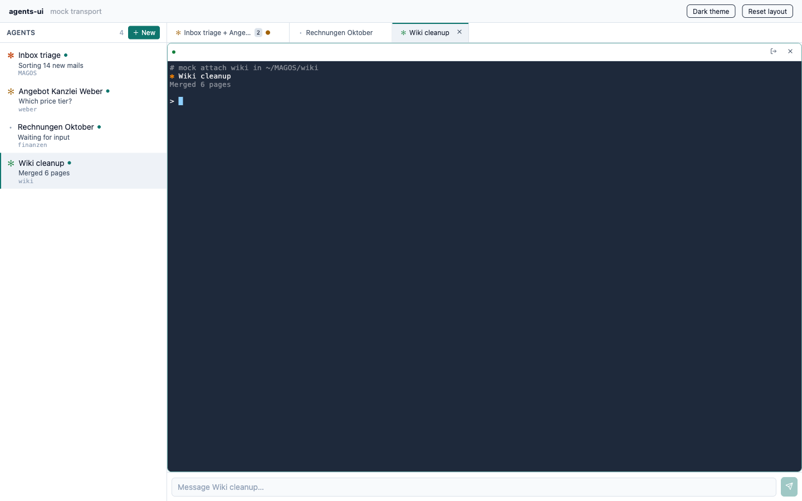

# agents-ui

The core of Orkumo's Agents view as a React package: agent list, xterm terminal, start dialog,
tabs with split/tiling, and a message box. The backend sits behind a small, swappable transport.



| 390px: list | 390px: panes | 390px: start dialog | Themed by the host |
| --- | --- | --- | --- |
|  |  |  |  |

## Install

```sh
bun add git+ssh://git@github.com/hpmartini/agents-ui.git   # git dependency (private repo: ssh access)
bun add file:../agents-ui                                  # local checkout
```

`github:hpmartini/agents-ui` and `git+https://` do not work with bun for this private repo (bun
fetches them as an unauthenticated tarball, 404). `dist/` is committed, so the git dependency works
without a build step on install. After changing
`src/`, run `bun run build` and commit `dist/` with it.

Peer dependencies: `react` and `react-dom` 19.

## Use

```tsx
import { AgentsPanel, createHttpTransport } from '@hpmartini/agents-ui';
import '@hpmartini/agents-ui/styles.css';

const transport = createHttpTransport({ baseUrl: '/api' });

<AgentsPanel transport={transport} defaultCwd="~/MAPLE" />;
```

`AgentsPanel` props:

| Prop | Default | |
| --- | --- | --- |
| `transport` | — | the backend, see below |
| `defaultCwd` | — | folder the start dialog proposes |
| `storageKey` | `'agents-ui:workspace'` | localStorage key for tabs and splits; `null` keeps nothing |
| `title` | `'Agents'` | list heading |
| `narrowBelowPx` | `720` | below this container width the panel shows list or panes, not both |
| `className` | — | on the root element |

The parts (`AgentList`, `AgentWorkspace`, `AgentTerminal`, `StartAgentDialog`, `ChatInput`) and the
pure tab/split model (`workspace.*`) are exported too, for hosts that want their own layout.

## The transport contract

The whole interface, in `src/transport.ts`:

```ts
interface AgentsTransport {
  subscribe(onAgents: (agents: Agent[]) => void): () => void; // full list on every change
  start(req: { cwd: string; prompt?: string; name?: string }): Promise<{ id: string }>;
  stop(id: string): Promise<void>;
  attach(id: string, size: { cols: number; rows: number }, h: PtyHandlers): PtyChannel;
}
interface Agent { id; name; cwd; displayState; detail?; startedAt }
interface PtyHandlers { onData(text); onExit(code | null); onError?(message); onOpen?() }
interface PtyChannel { write(data); resize(cols, rows); close() }
```

`displayState` is one of `working | waiting | needs-input | idle | completed | failed | stopped | loop | interactive`.
The message box needs no call of its own: it types into the agent's terminal (paste, then Enter).
`close()` only detaches; the agent keeps running.

Three implementations ship with it. One test suite (`test/transport.contract.test.ts`) runs
against all three.

### `createHttpTransport(options)` — HTTP + SSE + WebSocket

This is Orkumo's wire protocol, so a server that speaks it (Orkumo's, or one MAPLE builds) works as is:

| Call | Wire |
| --- | --- |
| `subscribe` | SSE `GET {baseUrl}/agents/stream`, event `sessions` with `Agent[]` as JSON (reconnects with backoff) |
| `start` | `POST {baseUrl}/agents/dispatch` `{cwd, prompt?, name?, idle}` → `{id}`; errors as `{error}` |
| `stop` | `POST {baseUrl}/agents/:id/stop` |
| `attach` | WS `{wsUrl}/pty?sessionId&cwd&cols&rows&command=claude&args=["attach",id]`; sends `{type:'input',data}` and `{type:'resize',cols,rows}`, receives `{type:'output',data}`, `{type:'exit',exitCode}`, `{type:'error',message}`, `{type:'connected'}` |

Options: `baseUrl` (`'/api'`), `wsUrl` (derived from `baseUrl` and the page origin), `command`
(`'claude'`), `attachArgs(id)`, and `fetch`, `EventSource`, `WebSocket` to inject (tests, auth headers).

### `createIpcTransport(bridge)` — Electron IPC

For a renderer without an HTTP server. The bridge is what a preload script exposes:

```ts
// preload.js
contextBridge.exposeInMainWorld('agentsBridge', {
  invoke: (channel, payload) => ipcRenderer.invoke(channel, payload),
  on: (channel, listener) => {
    const h = (_e, msg) => listener(msg);
    ipcRenderer.on(channel, h);
    return () => ipcRenderer.off(channel, h);
  },
});
// renderer
const transport = createIpcTransport(window.agentsBridge);
```

The main process answers these channels (`IPC_CHANNELS` in `src/transports/ipc.ts`):

| Channel | Direction | Payload |
| --- | --- | --- |
| `agents:list` | invoke | → `Agent[]` |
| `agents:changed` | main → renderer | `Agent[]` |
| `agents:start` / `agents:stop` | invoke | `StartAgentRequest` → `{id}` / `id` |
| `agents:pty:open` | invoke | `{ptyId, id, cols, rows}` (the renderer picks `ptyId`) |
| `agents:pty:input` / `:resize` / `:close` | invoke | `{ptyId, data}` / `{ptyId, cols, rows}` / `{ptyId}` |
| `agents:pty:event` | main → renderer | `{ptyId, type: 'output' \| 'exit' \| 'error', data? \| code? \| message?}` |

The main-process side is not part of this package. Orkumo's Electron app talks HTTP/WS to its own
server today, so it uses `createHttpTransport`.

### `createMockTransport(agents?, latencyMs?)`

In-memory, for demos and tests. Its terminals echo input and answer each line. Extra helpers:
`setAgents`, `update(id, patch)`, and `attachCount` (how often each agent was attached).

## Theming

The stylesheet is Tailwind v4, compiled, **without preflight**, so the host's base styles stay
untouched. Every colour is a CSS variable with a dark default. Set the variables on `.agents-ui`
or on any ancestor:

| Variable | Default | |
| --- | --- | --- |
| `--agents-bg` | `#0b1220` | panel background |
| `--agents-surface` | `#111827` | headers, list |
| `--agents-raised` | `#1c2536` | hover, selected |
| `--agents-border` | `#273244` | |
| `--agents-text` / `--agents-muted` / `--agents-faint` | `#e5e7eb` / `#9ca3af` / `#6b7280` | |
| `--agents-accent` / `--agents-on-accent` | `#3b82f6` / `#fff` | buttons, focus, active pane |
| `--agents-working` / `--agents-warn` / `--agents-ok` / `--agents-danger` | orange / yellow / green / red | state glyphs |
| `--agents-term-bg` / `--agents-term-fg` / `--agents-term-cursor` / `--agents-term-selection` | | terminal |
| `--agents-font` / `--agents-mono` | system UI / system mono | |

The terminal reads its `--agents-term-*` colours when it is created; a live theme switch reaches
new terminals only.

## Tabs and tiling

Same model as Orkumo: each tab holds a split tree of panes. Drag a tab onto a pane's edge to
split, use a pane's "move to own tab" to split it out, switch a tab between columns, rows and grid,
and move tabs with Alt+Shift+Arrow. Narrow panes stack below 400px each. The layout is kept in
localStorage, and panes of agents that disappear are closed. Terminals survive split and unsplit
without reattaching (a module-level registry per pane, as in Orkumo).

## Left out on purpose

PRs, cloud sessions, the projects rail, server panel, chat transcript view, browser and shell
panes, Ghostty, file links, peek, settings, harness picker and multi-instance targets.

## Develop

```sh
bun install
bun run demo        # Vite demo with the mock transport, http://localhost:5173
bun run test        # vitest: transport contract, tab/split model, panel
bun run typecheck
bun run build       # dist/ (ESM + .d.ts + styles.css)
```
