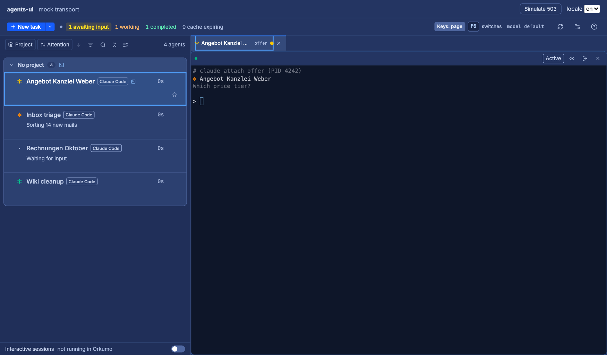
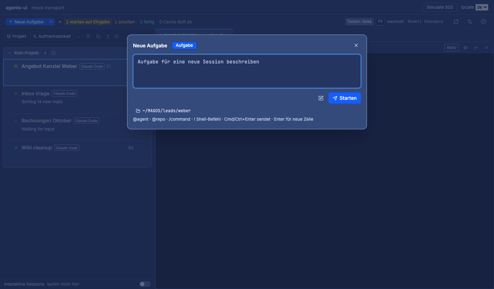
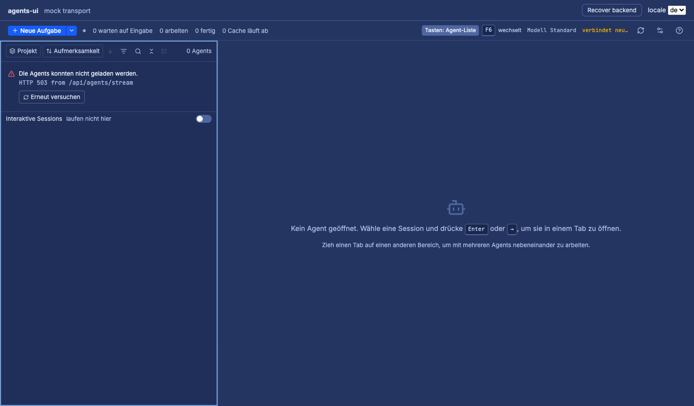

# agents-ui

Orkumo's Agents view as a React package. It covers the agent rail, xterm terminals, tabs and tiling,
the UI view (chat) with question cards, prompt suggestion, artifacts and paged history, the
composer, PRs, dev servers, orchestrators and settings. Orkumo and MAPLE both render this package.
Everything that talks to a server goes through a **transport**. Everything that belongs to the host app
goes through a **host** object: navigation, toasts, the command palette, the board and the built-in
browser. Every server capability is a transport group. Without that group the view hides what needs
it.

| Demo, `locale="en"` (Orkumo's wording) | `locale="de"`, composer | `locale="de"`, list fails (503) |
| --- | --- | --- |
|  |  |  |

How it was cut out of Orkumo, and what maps to what: [`docs/orkumo-inventory.md`](docs/orkumo-inventory.md).

## Install

```sh
bun add github:hpmartini/agents-ui#v0.4.12  # tagged release; dist/ is committed, no build on install
bun add file:../agents-ui                   # local checkout
```

Peer dependencies: `react` and `react-dom` 19. You need a bundler (Vite, webpack, bun), because
`dist/` uses extensionless imports and imports xterm's CSS. Under Vitest, inline the package with
`test.server.deps.inline: ['@hpmartini/agents-ui']`. After changing `src/`, run `bun run build` and
commit `dist/` with it.

## Use

```tsx
import { AgentsProvider, AgentsView, createLocalSettings } from '@hpmartini/agents-ui';
import '@hpmartini/agents-ui/styles.css'; // hosts without Orkumo's Tailwind setup

<AgentsProvider transport={transport} host={{ toast }} locale="de">
  <AgentsView canStop={(s) => s.name.startsWith('panel-')} confirmStop />
</AgentsProvider>;
```

The package exports every module under its own path as well, e.g.
`@hpmartini/agents-ui/utils/agentSessions` or `@hpmartini/agents-ui/hooks/useAgentSessions`. This is
how Orkumo's other pages use them.

### `AgentsProvider`

| Prop | |
| --- | --- |
| `transport` | `AgentsTransport`, see below |
| `host` | `AgentsHost`, see below; only `toast` is required |
| `locale` | `'en'` (default, Orkumo's wording) or `'de'` |
| `labels` | single texts to replace, per group: `{ shell?: {...}, terminal?: {...}, panels?: {...} }` (see `src/labels/*.ts`) |

A nested provider without `locale` and without `labels` keeps the outer provider's texts.

### `AgentsView`

Every prop is optional. The shell props are those of Orkumo's app shell.

| Prop | |
| --- | --- |
| `active` | the view is shown (keys, workspace); default `true` |
| `apps`, `nav`, `onExit`, `onOpenView`, `contextId`, `contextAppIds`, `children`, `railOutlet` | Orkumo's app shell: projects, activity rail, context switch. Other routes render as `children` while not `active`. `railOutlet`: the route lists its own items in the rail column (`RailOutletContext`); also while `active`, then the workspace shows beside it and `children` stay mounted, hidden |
| `selectedId` / `onSelectedIdChange` | opens this agent whenever the value changes and the agent is listed; reports the agent of the active pane |
| `prefill` / `onPrefillConsumed` | opens the composer with a prepared task |
| `canStop` | `(session) => boolean`; `false` hides Stop |
| `confirmStop` | asks before stopping (default `false`, as in Orkumo) |
| `className` | on the root, next to `agents-ui` |

If the agent list cannot be loaded before the first list arrives, the rail shows why. 401/403 means
no access, 5xx means the service is down, anything else is a load failure. Each case has a retry
button.

## Transport

`src/transport.ts` is the full contract. Method names and signatures are those of Orkumo's
`services/agentsApi.ts`. `agents`, `settings` and `pty.attach` are required. Every other group is
optional, and its presence is the capability flag:

| Group | What it enables |
| --- | --- |
| `agents` | list (pushed on change), start, stop |
| `settings` | view settings; a host without a server store uses `createLocalSettings(key)` |
| `pty.attach` / `pty.spawn` / `pty.shell` | attach to an agent; start client-side terminals (interactive harness, resume, cloud); plain shells |
| `chat` | UI view: transcript stream, paged history; optional `fetchChatStatus`, `fetchChatFiles`, `fetchChatDirs`, `fetchChatShell`, `chatImageUrl` |
| `artifacts` | files and pages a chat produced |
| `uploads` | images and files attached to prompts |
| `manage` | rename, pin, order, delete, respawn, raw JSON |
| `messaging` | reply to background jobs, type into panes, end panes |
| `contexts` | repo, PR, issue and server chips; PR panel and page |
| `discovery` | repos, subagents, slash commands, harnesses, models |
| `history` / `cloud` / `logs` | `/resume` picker / cloud sessions / peek panel and main agent dialog |
| `servers` / `daemon` / `orchestrator` | dev servers / background daemon / orchestrators and roles |
| `files` / `ghostty` / `targets` | open clicked paths / open in Ghostty / several agent instances (Orkumo #220) |

Question cards and prompt suggestions need no endpoint of their own. The view reads the terminal
screen and answers with keystrokes over the PTY, so they need `chat` (for the UI view) and `pty`.

`createMockTransport(sessions?, { latencyMs? })` is an in-memory transport for the demo and the
tests.

## Host

`src/host.tsx`, `AgentsHost`:

| Field | |
| --- | --- |
| `toast` | `info`, `success`, `error`, `dismiss`; required |
| `openCode`, `openBoard`, `openMode`, `openPulls`, `openProjectSettings`, `fetchRepoPath` | navigation to host pages; a missing one hides its entries |
| `useRegisterCommands`, `usePaletteOpen` | the host's command palette (called as hooks) |
| `renderActivityBar`, `headerSlot`, `onAttention` | app shell: mode rail, a slot after New task, window title. Without `renderActivityBar` the header gets its own agent-list switch, and Cmd/Ctrl+B toggles the list only while focus is inside the view |
| `renderPaneActions` | `({ paneId, session, orchestrator, role }) => ReactNode`: the host's buttons in the header of every agent pane (terminal and UI view, tabs and splits), before the pane's own actions. `session` is the agent's row, `orchestrator`/`role` as in the rail. Not on browser panes |
| `renderPaneView` | Same argument: a host view in place of the pane's body (tabs and splits, terminal and UI view), header kept; null shows the pane as usual. The terminal stays mounted and takes no focus while a view is shown |
| `useIssues`, `renderIssueModal`, `renderIssueCreate` | board issue chips and dialogs |
| `onQuickPrompt`, `onQuickChat` | the desktop quick window |
| `renderBrowser` | built-in browser pane; without it, links open in the system browser |
| `terminalOptions` | xterm options (e.g. a Ghostty theme); without them the CSS variables apply |

`configureLinks({ openExternal, embedsAnySite })` registers the platform's link handling once, at
startup (Orkumo: Electron's `shell.openExternal` and BrowserView).

## Theming

The components use Orkumo's Tailwind classes. Orkumo styles them with its own Tailwind setup. Other
hosts import `styles.css`, which is compiled with Tailwind v4 and has **no global preflight**: its
base rules apply only inside `.agents-ui`.

| Variable | Default (Orkumo) | |
| --- | --- | --- |
| `--agents-gray-50` … `--agents-gray-950` (incl. 750, 850) | Orkumo's blue-tinted scale | every `*-gray-*` class; 950 is the darkest, 50 the lightest |
| `--agents-sel`, `--agents-cursor` | `#3f6399`, `#8fd0ff` | selected rail row, focus outline |
| `--agents-white` | `#fff` | `text-white`/`bg-white` on the view's surfaces (selected row, hover, headings); solid colour buttons keep white |
| `--agents-{hue}-text` for blue, sky, indigo, violet, purple, fuchsia, pink, red, orange, amber, yellow, emerald | Tailwind's 100–400 | the light tints Orkumo uses as text and icon colours on dark surfaces; a light theme points them at darker colours. Tints of 500 and above (badges, buttons, `bg-*-500/20`) keep Tailwind's values |
| `--agents-font`, `--agents-font-mono` | Inter, JetBrains Mono | |
| `--agents-border`, `--agents-scrollbar`, `--agents-accent` | | kbd, scrollbars, width handle |
| `--agents-bg`, `--agents-text`, `--agents-mono`, `--agents-term-*` | | terminal colours and font when the host passes no `terminalOptions` |

Terminals pick up a theme switch on `<html>` or `<body>` (class, style, `data-theme`) by themselves.
After switching on another element, call `refreshTerminalTheme()`.

`ResizeHandle`, `useStoredWidth` and `clampWidth` are exported for a host's own resizable frame. MAPLE
uses them for its drawer.

## Develop

```sh
bun install
bun run demo        # Vite demo with the mock transport (?locale=de, ?fail=503)
bun run test        # vitest
bun run typecheck
bun run build       # dist/ (ESM + .d.ts + styles.css)
```
